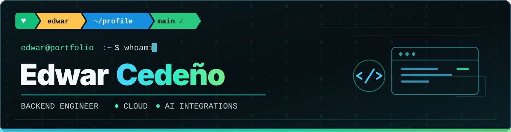

  

  
  
  

### `~/whoami`

**I'm not an endpoint. But I always respond to your requests.**

Backend-focused Software Engineer with **8+ years of experience** designing and building systems across **fintech, SaaS, trading, and data integrations**. I work primarily with Python and Node.js, with an emphasis on reliable APIs, cloud infrastructure, security-minded engineering, and practical AI integrations.

- **Engineering:** REST APIs, microservices, integrations, and production troubleshooting
- **Leadership:** led backend teams of **5–10 engineers**, with code reviews and mentoring
- **AI:** experience with **LangChain, MCP, agents, and tool integrations**

### `~/tech-stack`

**Backend**

**Cloud & Data**

**AI & Integrations**

### `~/selected-work`

| Work | What I contributed |
|:---|:---|
| **SaaS monetization · LetterBucket** | Stripe Connect, subscription flows, access control, magic links, and OTP authentication |
| **Fintech backend · Creed & Bear** | Python microservices, REST APIs, Docker, CI/CD, monitoring, and team leadership |
| **Integrations & ETL · Athmos** | API integrations, Python automation, data extraction, and full-stack delivery |

*These are professional case studies. Source code for proprietary work is not public.*

**[Explore the case studies on my portfolio →](https://edwarxdced.github.io/#projects)**

### `~/connect`

Open to **remote opportunities** and **freelance collaborations** involving backend engineering, cloud architecture, and AI integrations.

**[Portfolio](https://edwarxdced.github.io/)** · **[LinkedIn](https://www.linkedin.com/in/edwar-cedeno/)** · **[Email](mailto:edwarcedeno1994@gmail.com)**

`edwar@portfolio:~$` Building reliable systems, one request at a time.
